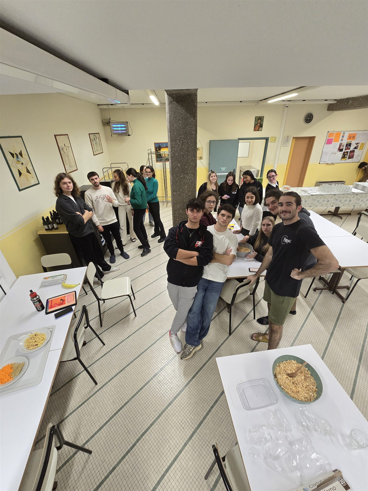

::: {.csf-hero .csf-hero--split}
::: {.csf-hero__body}
<p class="csf-hero__eyebrow"><i class="bi bi-geo-alt-fill"></i> Started in Padova · open to every city</p>

<h1 class="csf-hero__title">Cheap desserts.<br>New <em>friends</em>.</h1>

<p class="csf-hero__lede">
<strong>Cuochi senza fuochi</strong> (it means <em>cooks without fires</em>) is a group of
people who get together to make easy, cheap desserts and cakes, with no oven and no stove.
The cake is the excuse. <strong>The people you make it with are the point.</strong>
</p>

::: {.csf-actions}
[Come to the next one](join.qmd){.csf-btn .csf-btn--primary}
[How an evening works](how-it-works.qmd){.csf-btn .csf-btn--ghost}
:::

<div class="csf-hero__meta">
  <span><i class="bi bi-check-circle-fill"></i> Free to join</span>
  <span><i class="bi bi-check-circle-fill"></i> No oven, no skills</span>
  <span><i class="bi bi-check-circle-fill"></i> Come on your own</span>
  <span><i class="bi bi-check-circle-fill"></i> Italiano &amp; English</span>
</div>
:::

::: {.csf-hero__figure}
<span class="csf-sticker csf-sticker--butter" aria-hidden="true">No oven.<br>No stress.</span>
<span class="csf-sticker csf-sticker--berry" aria-hidden="true">Zero skills needed</span>

{.csf-hero__photo fig-alt="About eighteen people standing around tables in a common room in Padova, with bowls of crushed biscuits and ingredients laid out"}

<p class="csf-hero__caption">Most of these people met for the first time that evening.</p>
:::
:::

::: {.csf-section}
<p class="csf-section__kicker">who we are</p>
<h2 class="csf-section__title">A group of people, not a cooking school.</h2>
<p class="csf-section__sub">
Moving to a new city, you sort out a room and a commute in a few weeks. Finding people
takes longer. So we keep it simple: one table, one easy recipe, a bowl each, and whoever
turns up. While your hands are busy with biscuits and cream, talking to strangers just happens.
</p>

::: {.csf-grid}
::: {.csf-card .csf-card--berry}
<span class="csf-card__icon"><i class="bi bi-people-fill"></i></span>

### Together, never against
No jury, no score, no "best cake". We all make the same dessert together, and we all eat
it. The only thing that gets judged is how fast the tiramisù disappears.
:::

::: {.csf-card .csf-card--butter}
<span class="csf-card__icon"><i class="bi bi-piggy-bank-fill"></i></span>

### Cheap on purpose
Joining is free. Recipes are made from a few supermarket basics, so money is never the
reason someone stays home.
:::

::: {.csf-card .csf-card--pista}
<span class="csf-card__icon"><i class="bi bi-emoji-smile-fill"></i></span>

### Easy for everyone
No oven, no stove, no experience. If you can stir, crush a biscuit or lick a spoon, you
are already qualified.
:::
:::
:::

::: {.csf-quote}
Nobody wins. **Everybody eats.**

<cite>the whole idea, in four words</cite>
:::

::: {.csf-section}
<p class="csf-section__kicker">an evening with us</p>
<h2 class="csf-section__title">Four steps, and the first one takes a minute</h2>
<p class="csf-section__sub">No form, no fee, nothing to prepare. This is the whole format.</p>

::: {.csf-steps}
- ### Send us a message
  One message on Instagram, TikTok or YouTube. We reply with the place, the time and the
  dessert of the evening.

- ### Come empty-handed
  Don't cook and don't bring a dish. The ingredients and the bowls are already on the
  table when you arrive.

- ### Make it together
  Someone talks everyone through the recipe. You crush, mix and layer, chatting with
  whoever is standing next to you.

- ### Eat it, keep the people
  Into the fridge, onto the plates, gone. You go home with a recipe you can redo without
  a kitchen, and a few new names in your phone.
:::
:::

::: {.csf-section}
<p class="csf-section__kicker">what we make</p>
<h2 class="csf-section__title">Desserts and cakes that never see an oven</h2>
<p class="csf-section__sub">
A bowl, a spoon and a fridge: that's the whole kitchen. We post a new one on Instagram
every week, easy enough for a room full of people and cheap enough to make again at home.
</p>

```{=html}
<div class="csf-recipes csf-recipes--4">
<article class="csf-recipe">
  <a class="csf-recipe__img" href="recipes.html"></a>
  <div class="csf-recipe__body"><h3>Salame di cioccolato</h3><p class="csf-recipe__sub">our classic, party size</p></div>
</article>
<article class="csf-recipe">
  <a class="csf-recipe__img" href="recipes.html"></a>
  <div class="csf-recipe__body"><h3>Tiramisù, two ways</h3><p class="csf-recipe__sub">classic or with strawberries</p></div>
</article>
<article class="csf-recipe">
  <a class="csf-recipe__img" href="recipes.html"></a>
  <div class="csf-recipe__body"><h3>Gelato biscotto</h3><p class="csf-recipe__sub">ice-cream sandwiches, no machine</p></div>
</article>
<article class="csf-recipe">
  <a class="csf-recipe__img" href="recipes.html"></a>
  <div class="csf-recipe__body"><h3>Bounty</h3><p class="csf-recipe__sub">three ingredients, sticky fingers</p></div>
</article>
</div>
```

::: {.csf-actions style="margin-top:1.75rem"}
[See all the recipes](recipes.qmd){.csf-btn .csf-btn--ghost}
:::
:::

::: {.csf-section}
::: {.csf-split}
::: {}
<p class="csf-section__kicker">why come along</p>
<h2 class="csf-section__title">We're not the best cooks in town. We're good company.</h2>
<p class="csf-section__sub">
There are lots of good ways to meet people. This one is just very easy to say yes to,
whoever you are and however long you've been here.
</p>

::: {.csf-tags}
- New in town
- Erasmus and exchange
- PhD students and researchers
- Just started a job here
- Living in a cohousing or a shared flat
- Here for years, up for new faces
:::
:::

::: {.csf-checks}
- **You don't need to know anyone.** Most people come on their own. It's the normal way
  to arrive, and nobody stays a stranger for long.
- **You don't need to cook.** Every recipe is chosen so a total beginner gets it right
  the first time.
- **You don't need to spend.** Joining is free, and nobody collects money at the door.
- **You leave with more than dessert.** A recipe you can repeat with no kitchen, and
  people to share the next one with.
:::
:::
:::

::: {.csf-section}
<p class="csf-section__kicker">from the table</p>
<h2 class="csf-section__title">Recent sessions</h2>
<p class="csf-section__sub">Photos and short notes from the last few evenings. This is what you'd be walking into.</p>

::: {#latest-sessions}
:::

[See all sessions](events.qmd)
:::

::: {.csf-band .csf-band--butter}
<span class="csf-band__icon"><i class="bi bi-geo-alt-fill"></i></span>

## Started in Padova. Why not your city?

All it takes is **a table, a fridge and a few curious people.** We'll share our recipes
and how we run an evening, so you can host the first one wherever you live.

::: {.csf-actions}
[Start one in your city](cities.qmd){.csf-btn .csf-btn--primary}
[Read our story](about.qmd){.csf-btn .csf-btn--ghost}
:::
:::

::: {.csf-section}
<p class="csf-section__kicker">see it first</p>
<h2 class="csf-section__title">Watch one before you come to one</h2>
<p class="csf-section__sub">
Recipes, silly POVs and [interviews with our sweet guests](latest.qmd). Have a look,
and if you like what you see, a message on any of these is a perfectly good way to sign up.
</p>

<div class="csf-social">
  <a class="csf-social__card csf-social__card--ig" href="https://www.instagram.com/cuochi_senza_fuochi/">
    <span class="csf-social__icon"><i class="bi bi-instagram"></i></span>
    <span class="csf-social__name">Instagram</span>
    <span class="csf-social__handle">&#64;cuochi_senza_fuochi</span>
    <span class="csf-social__note">Photos from every session, and the next date in stories.</span>
    <span class="csf-social__cta">Follow</span>
  </a>
  <a class="csf-social__card csf-social__card--tt" href="https://www.tiktok.com/@cuochi_senza_fuochi">
    <span class="csf-social__icon"><i class="bi bi-tiktok"></i></span>
    <span class="csf-social__name">TikTok</span>
    <span class="csf-social__handle">&#64;cuochi_senza_fuochi</span>
    <span class="csf-social__note">Short clips of a dessert coming together. The fastest way to get the idea.</span>
    <span class="csf-social__cta">Watch</span>
  </a>
  <a class="csf-social__card csf-social__card--yt" href="https://www.youtube.com/@cuochisenzafuochi">
    <span class="csf-social__icon"><i class="bi bi-youtube"></i></span>
    <span class="csf-social__name">YouTube</span>
    <span class="csf-social__handle">&#64;cuochisenzafuochi</span>
    <span class="csf-social__note">Longer videos and full recipes anyone can redo without an oven.</span>
    <span class="csf-social__cta">Subscribe</span>
  </a>
</div>
:::

::: {.csf-band}
## Next session? Just turn up.

You don't need to know anyone, cook anything or bring anything. **Most people come on
their own the first time.**

::: {.csf-actions}
[Come to the next one](join.qmd){.csf-btn .csf-btn--primary}
[See the recipes](recipes.qmd){.csf-btn .csf-btn--ghost}
:::
:::
