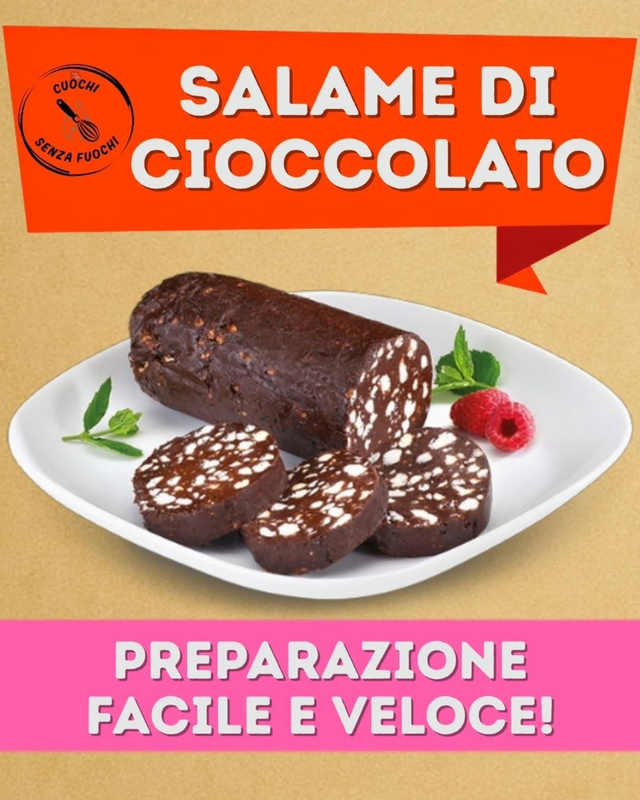
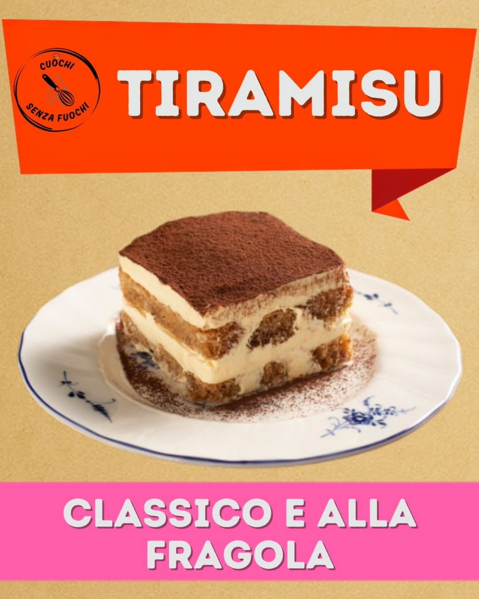
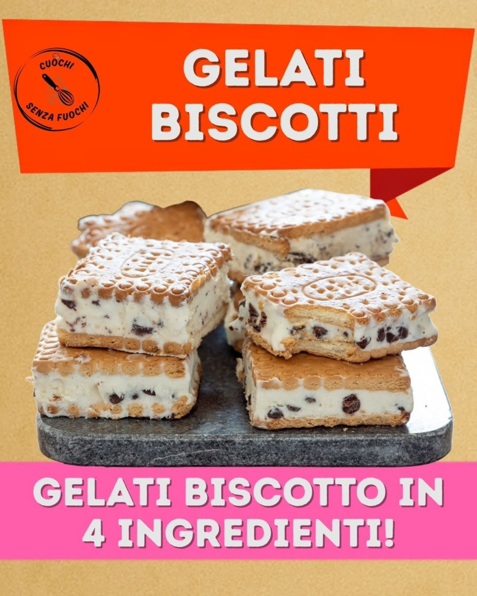
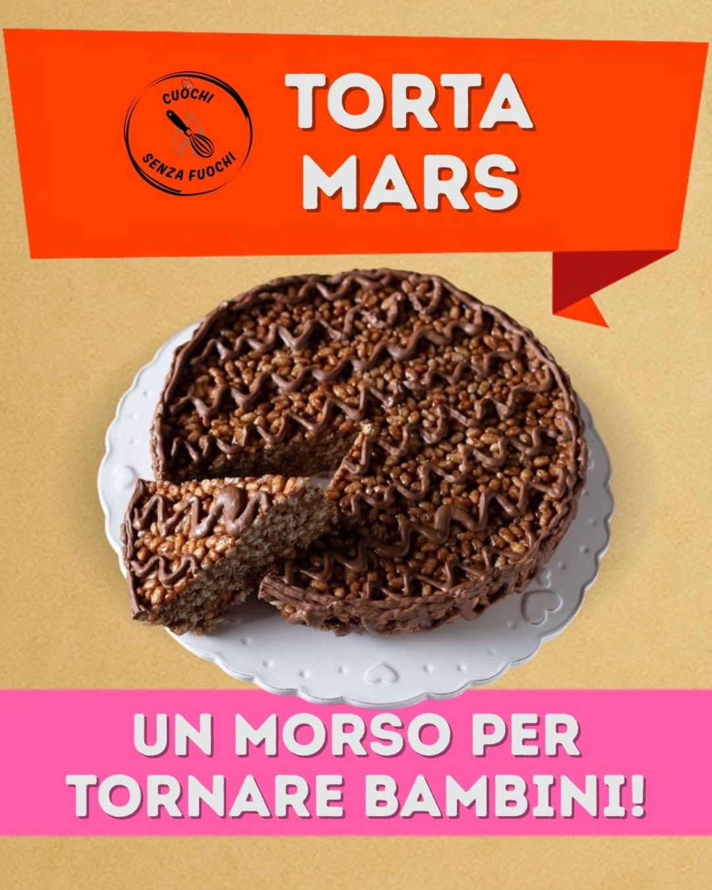
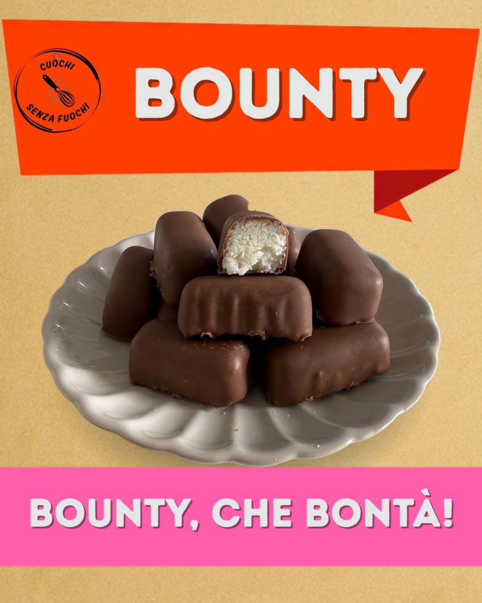
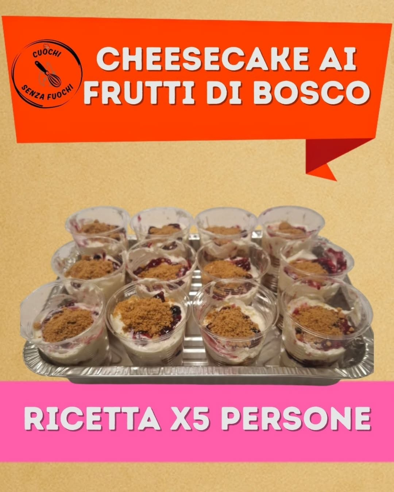
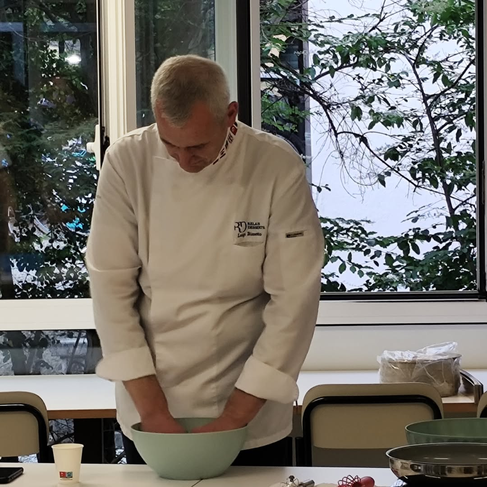

<!-- Every recipe here comes from a post on instagram.com/cuochi_senza_fuochi.
     Amounts and steps are copied from the post slides; photos are the post
     covers, saved in images/recipes/. Keep it/recipes.qmd in step. -->

::: {.csf-hero}
<p class="csf-hero__eyebrow"><i class="bi bi-cake2-fill"></i> No oven · no stove · no skills</p>

<h1 class="csf-hero__title">Cakes you can make in a <em>bedroom</em>.</h1>

<p class="csf-hero__lede">
Every week we post a new no-fire recipe on Instagram. These are the ones we make
together, <strong>with the exact amounts from our posts.</strong> Learn one with us,
then make it again on your own.
</p>

::: {.csf-actions}
[Come and make one](join.qmd){.csf-btn .csf-btn--primary}
[New recipe every week on Instagram](https://www.instagram.com/cuochi_senza_fuochi/){.csf-btn .csf-btn--ghost}
:::
:::

::: {.csf-section}
<p class="csf-section__kicker">from our Instagram</p>
<h2 class="csf-section__title">Our desserts, one post at a time</h2>
<p class="csf-section__sub">
Tap a photo to see the original post, or open a card for the ingredients and steps.
</p>

```{=html}
<div class="csf-recipes">

<article class="csf-recipe">
  <a class="csf-recipe__img" href="https://www.instagram.com/p/DXFVUbIjH7-/"></a>
  <div class="csf-recipe__body">
    <h3>Salame di cioccolato</h3>
    <p class="csf-recipe__sub">our classic, party size</p>
    <p>The one we make most. Crush, mix, roll, chill, slice: one big bowl makes six salami for a whole crowd.</p>
    <p class="csf-card__facts"><span><i class="bi bi-basket"></i> 5 ingredients</span><span><i class="bi bi-people"></i> makes 6 salami</span></p>
    <details>
      <summary>Ingredients and steps</summary>
      <h4>Ingredients</h4>
      <ul><li>2 kg dry biscuits</li><li>2 kg sugar</li><li>1 kg butter</li><li>15 eggs (about 800 g)</li><li>500 g unsweetened cocoa</li></ul>
      <h4>Steps</h4>
      <ol><li>Break the biscuits roughly.</li><li>Melt the butter.</li><li>Add the sugar, the melted butter and then the cocoa.</li><li>Mix everything together.</li><li>Shape the salami using baking paper.</li></ol>
    </details>
    <p class="csf-recipe__links"><a href="https://www.instagram.com/p/DXFVUbIjH7-/">See the post</a><a href="https://www.youtube.com/watch?v=xhdRcyf1rMo">Watch the 4-minute version</a></p>
  </div>
</article>

<article class="csf-recipe">
  <a class="csf-recipe__img" href="https://www.instagram.com/p/DXrER9UDCrG/"></a>
  <div class="csf-recipe__body">
    <h3>Tiramisù, two ways</h3>
    <p class="csf-recipe__sub">classic or with strawberries</p>
    <p>Our signature, served in a cup: one with coffee, one with milk and fresh strawberries.</p>
    <p class="csf-card__facts"><span><i class="bi bi-basket"></i> 7 ingredients</span><span><i class="bi bi-cup"></i> 1 cup</span></p>
    <details>
      <summary>Ingredients and steps</summary>
      <h4>Ingredients (one cup)</h4>
      <ul><li>1 egg</li><li>30 g sugar</li><li>50 g cream</li><li>90 g mascarpone</li><li>3–4 savoiardi</li><li>Classic: instant coffee</li><li>Strawberry: milk and strawberries</li></ul>
      <h4>Steps</h4>
      <ol><li>Separate the yolk from the white.</li><li>Whip the yolk with 20 g of the sugar.</li><li>Whip the white and the cream with the other 10 g of sugar, then add the mascarpone.</li><li>Fold the two creams together.</li><li>Dip the savoiardi in coffee (or in milk, with the strawberries) and build the layers.</li></ol>
    </details>
    <p class="csf-recipe__links"><a href="https://www.instagram.com/p/DXrER9UDCrG/">See the post</a></p>
  </div>
</article>

<article class="csf-recipe">
  <a class="csf-recipe__img" href="https://www.instagram.com/p/DWPdU3DjNFa/"></a>
  <div class="csf-recipe__body">
    <h3>Gelato biscotto</h3>
    <p class="csf-recipe__sub">ice-cream sandwiches, no machine</p>
    <p>Whipped cream and chocolate between two biscuits, straight into the freezer. Twenty-five of them from four ingredients.</p>
    <p class="csf-card__facts"><span><i class="bi bi-basket"></i> 4 ingredients</span><span><i class="bi bi-snow"></i> makes 25</span></p>
    <details>
      <summary>Ingredients and steps</summary>
      <h4>Ingredients</h4>
      <ul><li>400 g dry biscuits</li><li>500 ml cream</li><li>125 g icing sugar</li><li>200 g chocolate</li></ul>
      <h4>Steps</h4>
      <ol><li>Whip the cream with a whisk.</li><li>Mix in the sugar.</li><li>Stir in the chocolate.</li><li>Spread the cream between the biscuits.</li><li>Put them in the freezer.</li></ol>
    </details>
    <p class="csf-recipe__links"><a href="https://www.instagram.com/p/DWPdU3DjNFa/">See the post</a></p>
  </div>
</article>

<article class="csf-recipe">
  <a class="csf-recipe__img" href="https://www.instagram.com/p/DX7rurnDCig/"></a>
  <div class="csf-recipe__body">
    <h3>Torta Mars</h3>
    <p class="csf-recipe__sub">crunchy, gooey, gone in minutes</p>
    <p>Mars bars melted with butter, puffed rice stirred in, pressed into a tin and left in the fridge.</p>
    <p class="csf-card__facts"><span><i class="bi bi-basket"></i> 4 ingredients</span><span><i class="bi bi-snow"></i> 1 hour in the fridge</span></p>
    <details>
      <summary>Ingredients and steps</summary>
      <h4>Ingredients (one cake)</h4>
      <ul><li>6 Mars bars (45 g each)</li><li>80 g butter</li><li>100 g puffed rice</li><li>Half a bar of milk chocolate</li></ul>
      <h4>Steps</h4>
      <ol><li>Cut the Mars bars into small pieces and melt them with the butter.</li><li>Add the puffed rice a little at a time.</li><li>Pour it all into a tin lined with baking paper and level it with a glass.</li><li>Put the cake in the fridge for at least an hour.</li></ol>
    </details>
    <p class="csf-recipe__links"><a href="https://www.instagram.com/p/DX7rurnDCig/">See the post</a></p>
  </div>
</article>

<article class="csf-recipe">
  <a class="csf-recipe__img" href="https://www.instagram.com/p/DYNcrjriHjT/"></a>
  <div class="csf-recipe__body">
    <h3>Bounty</h3>
    <p class="csf-recipe__sub">three ingredients, sticky fingers</p>
    <p>Coconut and condensed milk, shaped by hand and coated in milk chocolate.</p>
    <p class="csf-card__facts"><span><i class="bi bi-basket"></i> 3 ingredients</span><span><i class="bi bi-people"></i> makes 12</span></p>
    <details>
      <summary>Ingredients and steps</summary>
      <h4>Ingredients</h4>
      <ul><li>200 ml condensed milk</li><li>225 g desiccated coconut</li><li>300 g milk chocolate</li></ul>
      <h4>Steps</h4>
      <ol><li>Mix the condensed milk with the coconut.</li><li>Shape the bars and coat them in chocolate.</li><li>Decorate with the leftover coconut.</li></ol>
    </details>
    <p class="csf-recipe__links"><a href="https://www.instagram.com/p/DYNcrjriHjT/">See the post</a></p>
  </div>
</article>

<article class="csf-recipe">
  <a class="csf-recipe__img" href="https://www.instagram.com/p/DV9eBVaDI8R/"></a>
  <div class="csf-recipe__body">
    <h3>Berry cheesecake cups</h3>
    <p class="csf-recipe__sub">cheesecake ai frutti di bosco</p>
    <p>Yogurt and whipped cream layered with crumbled cocoa biscuits and berry jam, in little cups.</p>
    <p class="csf-card__facts"><span><i class="bi bi-basket"></i> 5 ingredients</span><span><i class="bi bi-people"></i> serves 5</span></p>
    <details>
      <summary>Ingredients and steps</summary>
      <h4>Ingredients</h4>
      <ul><li>Whole white yogurt (190 g)</li><li>Cream (50 g)</li><li>Icing sugar (6 g)</li><li>Cocoa shortbread biscuits</li><li>Mixed berry jam</li></ul>
      <h4>Steps</h4>
      <ol><li>Whip the cream (already sweetened is even better).</li><li>Crumble the biscuits into the bottom of the cup.</li><li>Fold the cream into the yogurt without knocking the air out, and pour it over the biscuits.</li><li>Add a second layer of crumbled biscuits, with a layer of jam on top.</li><li>Finish with another layer of cream, covered in jam.</li></ol>
      <p>Full amounts for five are on the post.</p>
    </details>
    <p class="csf-recipe__links"><a href="https://www.instagram.com/p/DV9eBVaDI8R/">See the post</a></p>
  </div>
</article>

</div>
```
:::

::: {.csf-section}
<p class="csf-section__kicker">a very special guest</p>
<h2 class="csf-section__title">The night a master pastry chef cooked with us</h2>

```{=html}
<div class="csf-recipes">
<article class="csf-recipe csf-recipe--guest">
  <a class="csf-recipe__img" href="https://www.instagram.com/p/DZIvNVPDJe7/"></a>
  <div class="csf-recipe__body">
    <h3>Chocolate mousse with Luigi Biasetto</h3>
    <p class="csf-recipe__sub">25 May 2026</p>
    <p>Padova's best-known pastry chef joined us for an evening and made a chocolate mousse with everyone at the table.</p>
    <p class="csf-recipe__links"><a href="https://www.instagram.com/p/DZIvNVPDJe7/">See the photos</a><a href="latest.html">More sweet guests</a></p>
  </div>
</article>
</div>
```
:::

::: {.csf-section}
::: {.csf-split}
::: {}
<p class="csf-section__kicker">and also</p>
<h2 class="csf-section__title">More on video</h2>
<p class="csf-section__sub">
A few more favourites live on YouTube. And yes, once we made a savoury one:
[tramezzini, three ways](https://www.instagram.com/p/DXXk8PtDPfi/).
</p>
:::

::: {.csf-checks}
- **[Sacher truffles](https://www.youtube.com/watch?v=r14EIY-7eX0).** The easy dessert for
  groups who think cooking is an impossible science.
- **[A 3-ingredient coconut dessert](https://www.youtube.com/watch?v=ZXGIKHwHM-8).** No
  appliances at all.
- **[Coconut tiramisù for 70 people](https://www.youtube.com/watch?v=pCKiMFqrsL0).** In one
  hour. Is it possible?
- **[No-dough pancakes](https://www.youtube.com/watch?v=nSHhefm6wzY).** For the student
  with an empty cupboard.
:::
:::
:::

::: {.csf-section}
::: {.csf-split}
::: {}
<p class="csf-section__kicker">how we pick them</p>
<h2 class="csf-section__title">Why these and not others</h2>
<p class="csf-section__sub">
A recipe has to pass four tests before it makes it onto our table.
</p>

Got a favourite no-bake dessert that passes all four? Bring the idea (not the dessert)
to the next session.
:::

::: {.csf-checks}
- **Nothing needs a flame.** No oven, no stove, no waiting for a shared kitchen to free up.
- **It's cheap.** Supermarket basics that feed a whole table.
- **The steps split up.** Someone crushes, someone melts, someone rolls. If only one pair
  of hands can make it, it's the wrong recipe for a group.
- **You can make it again alone.** In a bedroom with a fridge down the hall, which is the
  whole point.
:::
:::
:::

::: {.csf-band}
## Pick one and come and make it

You don't need to buy anything or practise first. Just turn up.

::: {.csf-actions}
[Come to the next one](join.qmd){.csf-btn .csf-btn--primary}
[Watch the videos](latest.qmd){.csf-btn .csf-btn--ghost}
:::
:::
